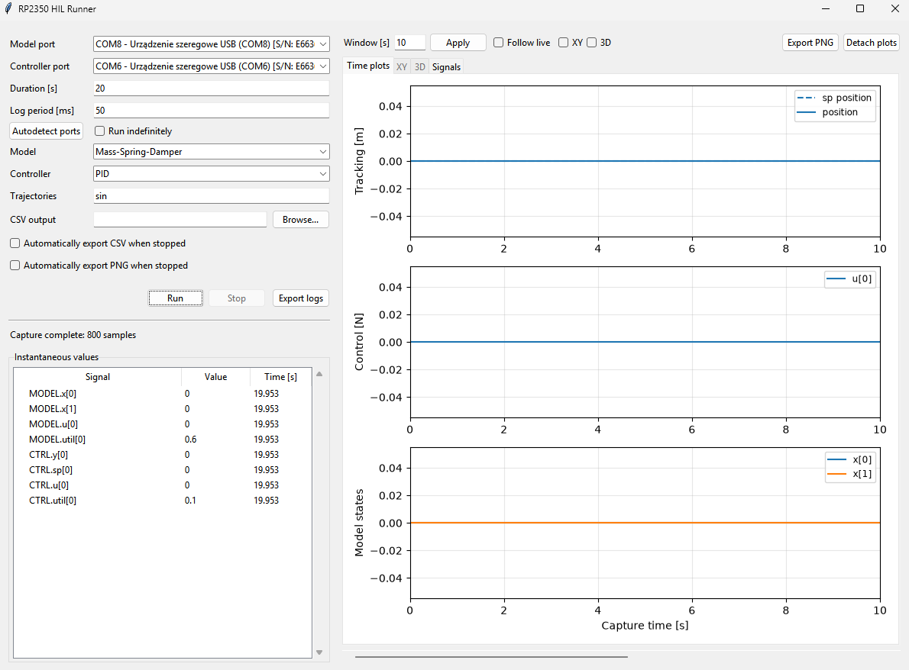
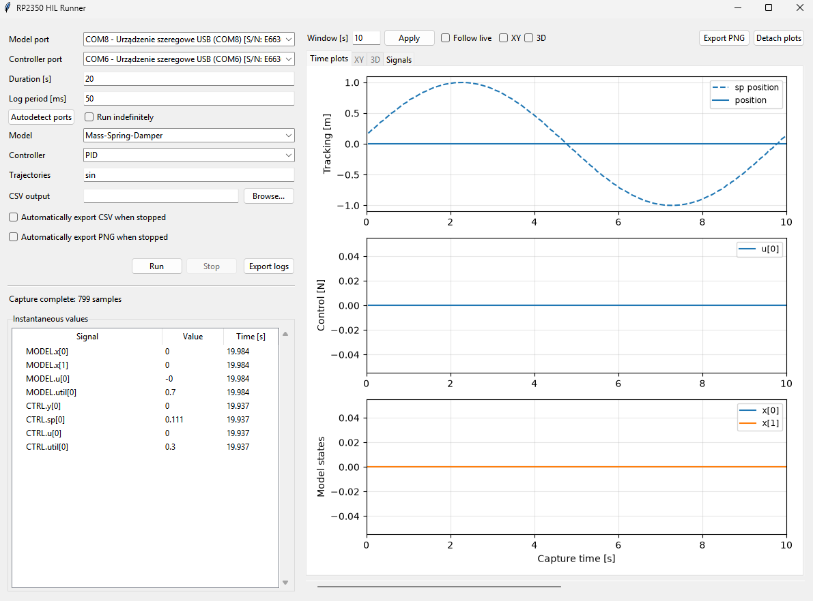
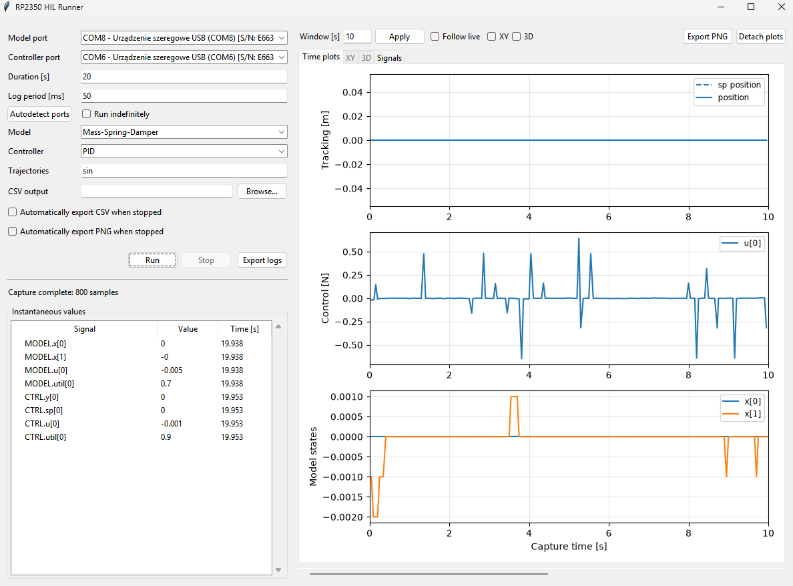
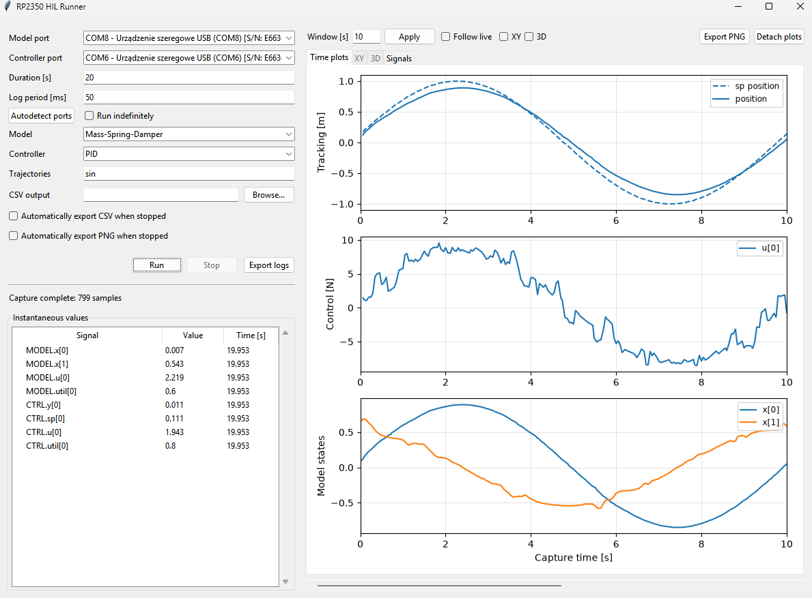

# HIL Model — RP2350

Fixed-step ODE solver with pluggable dynamic models for Hardware-in-the-Loop simulation on RP2350.

## Overview

The project allows you to run HIL testing using Raspberry Pi RP2350 boards. One of the boards serves as the "model" board, running a fixed-step ODE solver with a pluggable dynamic model (mass-spring-damper, pendulum-on-cart, double-pendulum, 3R manipulator, unicycle). The other board serves as the "controller" board, running a control law (PID, decoupling, or unicycle linearization) that reads the model outputs and drives the model inputs.

The communication between the model <-> controller boards is done in two ways:

- **UART1**: for commands between the boards, e.g. model selection and reset. PC commands and telemetry use UART0 on each board.
- **PWM**: for real-time model I/O (8 channels each).

The task is to implement a controller for a given model. Models live in the `models/` directory and implement various physical systems. Since the implementation is done in C, a polymorphism-like implementation was derived using a common interface from `models/model.h`. Similarly, controllers live in the `controllers/` directory and implement a common interface from `inc/controller.h`. The controller is selected at runtime using the `$CTRL,<id>` command.

## Available Models, Controllers and Trajectories

Names and IDs below match the firmware catalogs (`$MODELS`, `$CTRLS`, `$TRAJS`). Controller and trajectory descriptions refer to completed implementations; student stubs initially output zero.

### Models

- **0 — Off (default):** Disables model simulation.
- **1 — Mass-Spring-Damper:** A mass connected to a spring and damper, driven by a force. Used for position tracking and parameter identification.
- **2 — Pendulum-Cart:** A cart carrying a freely rotating pendulum, driven by a horizontal force. Used for cart tracking or pendulum swing-up and balancing.
- **3 — Double-Pendulum:** Two coupled pendulum links with two torque inputs. Used for joint-angle tracking.
- **4 — 3R-Manipulator:** A robot arm with three revolute joints and three torque inputs. Used for Cartesian end-effector tracking.
- **5 — Unicycle:** A kinematic mobile robot driven by linear and angular velocity commands.
- **6 — Unicycle-Dynamic:** A mobile robot model including mass and inertia, driven by two wheel torques.

### Controllers

- **0 — Off (default):** Disables controller updates and sets all PWM outputs to neutral (50% duty).

For unicycle controllers, **Kin** selects the kinematic model and outputs velocities; **Dyn** selects the dynamic model and outputs wheel torques.

- **1 — PID:** Tracks the mass-spring-damper position using proportional, integral and derivative feedback, with saturation and anti-windup.
- **2 — IO-Decoupling-3R:** Uses model-based input/output decoupling to track a Cartesian end-effector path with the 3R arm.
- **3/4 — Static-Lin-Unicycle-Kin/Dyn:** Tracks a guidance point offset from the robot's axle using static feedback linearization.
- **5/6 — Dynamic-Lin-Unicycle-Kin/Dyn:** Tracks a guidance point on the axle using feedback linearization with an additional controller state. Requires a nonzero extended velocity.
- **7/8 — Samson-Unicycle-Kin/Dyn:** Tracks a moving reference pose using position and heading errors expressed in the robot frame.
- **9 — FF-Double-Pendulum:** Combines inverse dynamics with feedback to track both pendulum angles.
- **10 — FF-Pendulum-Cart:** Uses partial feedback linearization to track cart position; it does not balance the pendulum upright.
- **11 — FF-MDS:** Tracks mass-spring-damper position using computed force with known mass, damping and stiffness.
- **12–14 — MDS-Adaptive-Mass/Damping/Stiffness:** Tracks position while estimating one unknown plant parameter online. The estimate need not converge to its true value.
- **15–17 — MDS-Robust-Mass/Damping/Stiffness:** Tracks position while compensating for bounded uncertainty in one plant parameter.
- **18–20 — MDS-Estimator-Mass/Damping/Stiffness:** Applies an internal excitation force to identify one plant parameter. These slots ignore the tracking setpoint.
- **21 — Upright-Pendulum-Cart:** Swings the pendulum up from hanging, then balances it upright while regulating cart position.
- **22 — Custom:** A template for your own controller; it outputs zero until implemented.

### Trajectories

Each trajectory supplies one setpoint channel; a constant setpoint can also be selected with `$SP,<channel>,<value>`.

- **0 — Sin:** A smooth sinusoidal reference with configurable amplitude, rate and bias.
- **1 — PWM:** A square-wave reference with configurable frequency, duty cycle and levels. Both default levels are zero, so change them to obtain switching.
- **2 — Triangle:** A periodic linear rise and fall between two levels.
- **3 — Saw:** A periodic linear ramp followed by a jump back to the starting level.
- **4 — Circle-X:** The cosine-based x coordinate of the predefined spatial path.
- **5 — Circle-Y:** The sine-based y coordinate, paired with Circle-X for planar motion.
- **6 — Circle-Z:** A scaled cosine-based z coordinate; combine all three coordinates for the 3R spatial path.

## Your Task

To tune parameters without recompiling, open `scripts/hil_ui.py`, select your
model/controller/trajectories, stop any run, and open the **Parameters** tab.
Click **Read parameters**, double-click a value (PID shows **P**, **I**, **D**),
then click **Apply**. Only fields for your selections are shown. Repeated
trajectory types share one parameter set. Changes survive resets but not a
board reboot. Start a new run to reset the pair with the new settings.

The common UART commands are `$PGET,<kind>,<id>*<XOR>\r\n` and
`$PSET,<kind>,<id>,<values...>*<XOR>\r\n`, where kind is M/C/T. Reads return
`OK,PGET,<kind>,<id>,1,<values...>`; writes use the same complete ordered list.

Implement `update()` in the assigned `controllers/*_empty.c` file; `init()` and `reset()` are already provided. For trajectory tasks, fill in `src/trajectory_empty.c`. Rebuild with `HIL_REAL_CONTROLLERS=OFF` and the corresponding external-library option `OFF` to use your code.

## Communication

For manual testing of the controllers, you can derive e.g. a simple Python script that will oversee the communication. By default CRC checking is enabled for the communication protocol `src/comm.c`. To turn off the CRC checking send following command to the model/controller board:
`$CRC,0*4E` to disable CRC check.
Disable CRC checking separately on each board if you want to communicate manually without calculating CRC for every command. Then you can append a placeholder CRC value, e.g. `$SP,0,1.0*00` to set controller setpoint channel 0 to 1.0. Each command must still end with `\r\n`.

Both model and controller utilize two UARTs.

### Model Board

UART0 is used for communication and telemetry via PC. It is connected to a Raspberry Pi Pico acting as Debug Probe, thus available via USB. The default baud rate is 115200, 8N1. The commands are sent in the form of `$<CMD>,<args>*<XOR>\r\n` and the responses are sent back in the same format. The commands are parsed by `src/comm.c` and handled by the appropriate functions.
UART1 is used for communication with the controller board.

### Controller Board

UART0 is used for communication and telemetry via PC. It is connected to a Raspberry Pi Pico acting as Debug Probe, thus available via USB. The default baud rate is 115200, 8N1. The commands are sent in the form of `$<CMD>,<args>*<XOR>\r\n` and the responses are sent back in the same format. The commands are parsed by `src/comm.c` and handled by the appropriate functions.
UART1 is used for communication with the model board.

## Board Schematics

GPIO 22 LED: 1000 ms blink period when idle, 200 ms while a model/controller
is selected; both 50% duty. Both boards start in Off (index 0).
Use `$MODEL,0` on the model board and `$CTRL,0` on the controller board to
return to idle. Selecting any non-Off slot, including a student stub, switches
that board to 200 ms. Controller Off clears all PWM outputs to neutral (50% duty).
The controller sends no model selection at boot.
Controller IDs have shifted by one (PID is now 1, Custom is 22); reflash both
boards and update any manual numeric controller commands.

The schematic for the board can be found in [schematics](HIL_Testing_Platform_RP2350.pdf). The board has 8 PWM inputs and 8 PWM outputs, which are used to read the model outputs and drive the model inputs. The board also has two UARTs. Both are configured as 115200 baud 8N1.

## Project Structure

Key project files:

```
├── inc/
│   ├── ode.h              # ODE solver API
│   ├── controller.h       # Abstract controller interface
│   └── trajectory.h       # Setpoint-trajectory interface
├── controllers/
│   ├── controller.h       # (re-exported) abstract controller interface
│   ├── pid_ctrl.h/.c                 # Per-channel PID
│   ├── io_decoupling_3r.h/.c         # 3R input/output decoupling
│   ├── static_lin_unicycle_kin.h/.c  # Unicycle static lin. (kinematic model)
│   ├── static_lin_unicycle_dyn.h/.c  # Unicycle static lin. (dynamic model)
│   ├── dynamic_lin_unicycle_kin.h/.c # Unicycle dynamic lin. (kinematic model)
│   ├── dynamic_lin_unicycle_dyn.h/.c # Unicycle dynamic lin. (dynamic model, δ=π/2)
│   └── *_empty.c                     # Templates for controller implementations
├── models/
│   ├── model.h            # Model interface (function pointers)
│   ├── model.c
│   ├── mds.h              # Mass-Damper-Spring model
│   ├── mds.c
│   ├── pendulum_cart.h    # Pendulum-on-a-cart model
│   ├── pendulum_cart.c
│   ├── double_pendulum.h  # Double-pendulum model
│   ├── double_pendulum.c
│   ├── manipulator_3r.h   # 3R manipulator model
│   ├── manipulator_3r.c
│   ├── unicycle.h         # Kinematic and dynamic unicycle models
│   └── unicycle.c
├── src/
│   ├── ode.c              # RK4 solver implementation
│   ├── trajectory.c       # Predefined setpoint trajectories
│   ├── main_model.c       # Embedded entry point (HIL Model)
│   ├── main_ctrl.c        # Embedded entry point (HIL Controller)
│   └── trajectory_empty.c # Trajectory template for student builds
├── ext/
│   └── libs-stm32/                 # External static lib (circ_buff, eprintfs, ealgebra)
└── CMakeLists.txt          # Embedded build (Pico SDK)
```

## Toolchain Requirements

To use the provided precompiled libraries, use the versions configured in [CMakeLists.txt](CMakeLists.txt):

- **Arm GNU Toolchain 14.2.Rel1** (`14_2_Rel1`, GCC 14.2.1).
- **Raspberry Pi Pico SDK 2.2.0**.

Keep the project's default RP2350 target and compiler settings so the architecture and ABI (including floating-point calling conventions) match the libraries. If you change these settings or the public headers, use compatible rebuilt libraries.

## Compilation

With the Pico SDK and RP2350 toolchain installed, build the project using the following commands from the project root. These examples use Git Bash on Windows; adjust the Ninja path if your installation differs:

```bash
cmake -S . -B build -G Ninja -DCMAKE_MAKE_PROGRAM=/c/Users/$USERNAME/.pico-sdk/ninja/v1.12.1/ninja.exe -DHIL_REAL_CONTROLLERS=OFF -DHIL_USE_EXTERNAL_CONTROLLERS=OFF -DHIL_USE_EXTERNAL_TRAJECTORIES=OFF
cmake --build build -j16
```

The commands above explicitly select the student build with `HIL_REAL_CONTROLLERS=OFF`. This uses the "empty" trajectory and controller implementations, which initially output zero. Implement them according to the assigned tasks. The CMake default is `ON`, which selects the real implementations instead.

It is possible to use provided external static libraries separately for trajectories and controllers. This allows to familiarize with the behaviour of the system without the need of implementation. To use external libraries you need to set additional CMake options. The examples expect the archives in `libs/`; adjust the paths to their actual locations. Each example sets both import switches explicitly because CMake remembers their previous values in `build/`.


**Notice that neither control values nor trajectory-generated desired values are being generated, even though a sine trajectory is selected.**

### Using trajectories library

```bash
cmake -S . -B build -G Ninja -DCMAKE_MAKE_PROGRAM=/c/Users/$USERNAME/.pico-sdk/ninja/v1.12.1/ninja.exe -DHIL_REAL_CONTROLLERS=OFF -DHIL_USE_EXTERNAL_CONTROLLERS=OFF -DHIL_USE_EXTERNAL_TRAJECTORIES=ON -DHIL_TRAJECTORIES_LIBRARY=libs/libHIL_Trajectories.a
cmake --build build -j16
```


**Notice that now the desired value is available as a sine function.**

### Using controllers library

```bash
cmake -S . -B build -G Ninja -DCMAKE_MAKE_PROGRAM=/c/Users/$USERNAME/.pico-sdk/ninja/v1.12.1/ninja.exe -DHIL_REAL_CONTROLLERS=OFF -DHIL_USE_EXTERNAL_CONTROLLERS=ON -DHIL_CONTROLLERS_LIBRARY=libs/libHIL_Controllers.a -DHIL_USE_EXTERNAL_TRAJECTORIES=OFF
cmake --build build -j16
```


**Notice that now the controller is operational, but trajectory-generated desired values remain zero. The control values can respond to the measured state and measurement noise.**

### Using both trajectories and controllers libraries

```bash
cmake -S . -B build -G Ninja -DCMAKE_MAKE_PROGRAM=/c/Users/$USERNAME/.pico-sdk/ninja/v1.12.1/ninja.exe -DHIL_REAL_CONTROLLERS=OFF -DHIL_USE_EXTERNAL_CONTROLLERS=ON -DHIL_CONTROLLERS_LIBRARY=libs/libHIL_Controllers.a -DHIL_USE_EXTERNAL_TRAJECTORIES=ON -DHIL_TRAJECTORIES_LIBRARY=libs/libHIL_Trajectories.a
cmake --build build -j16
```


**The system now generates trajectories and the controller is operational.**

## Host UI

The Python UI application allows for testing of the prepared controller solution and plotting live data. It particularly useful when first version of controller is ready and there is a need to test it.

Install the Python dependencies and launch the UI from the project root:

```bash
python -m pip install -r requirements.txt
python scripts/hil_ui.py
```

The UI starts with **Off** for both model and controller. Select the two console
ports (or use **Autodetect ports**), choose the model/controller pair, and click
**Run** to apply the selection and capture telemetry. Either board can remain
**Off** independently. Choose **Off** and click **Run** to return a board to idle.
Use **Stop** to end capture; it leaves the selected model/controller running.

The GUI supports:

- **Live plots:** desired and measured outputs, control signals, and model states.
- **Instantaneous values:** a numeric table of all telemetry channels from both boards.
- **Custom plots:** selectable XY/3D views and a **Signals** tab for overlaying channels, plotting errors, and applying basic arithmetic.
- **Plot history:** follow live data, scroll through earlier samples, and detach plots into a separate window.
- **Logging:** capture for a fixed duration or until **Stop**; save captured samples to CSV with **Export logs** or enable automatic CSV export before a run.
- **Plot export:** save the active plot and visible time window as PNG with **Export PNG**, or enable automatic detailed PNG export on completion. Automatic CSV and PNG export are off by default.
